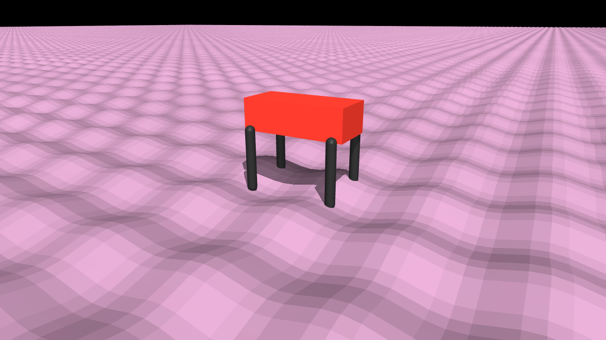
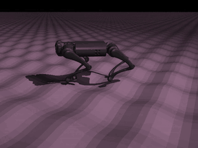
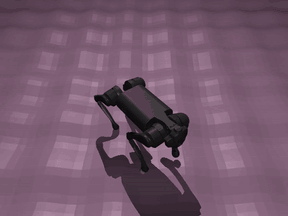
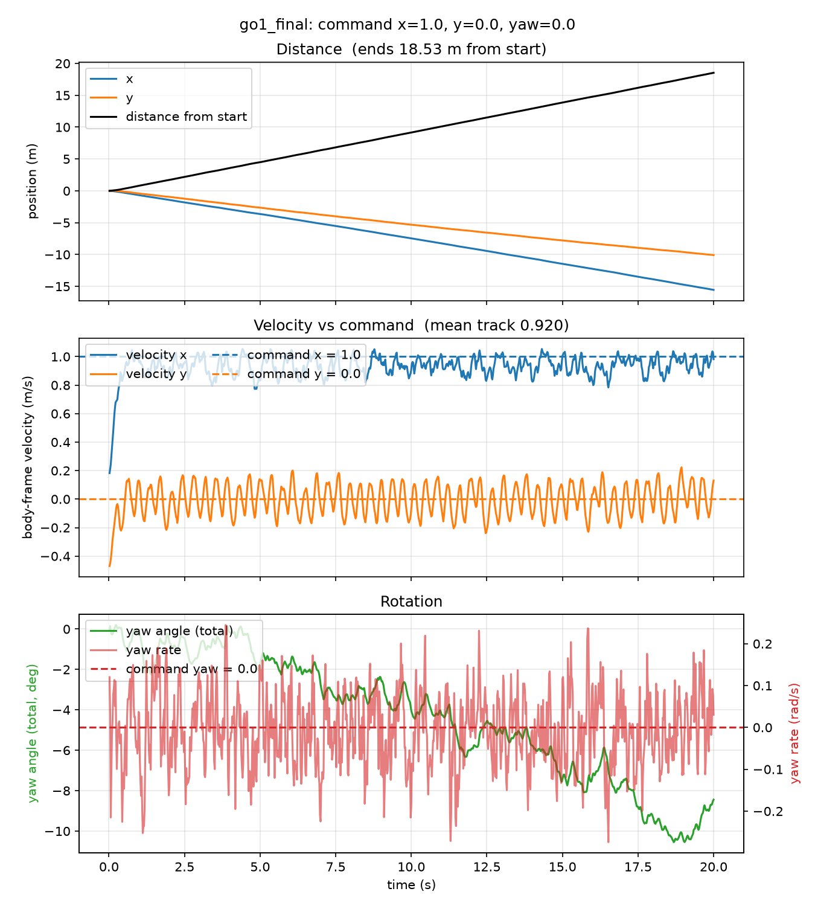
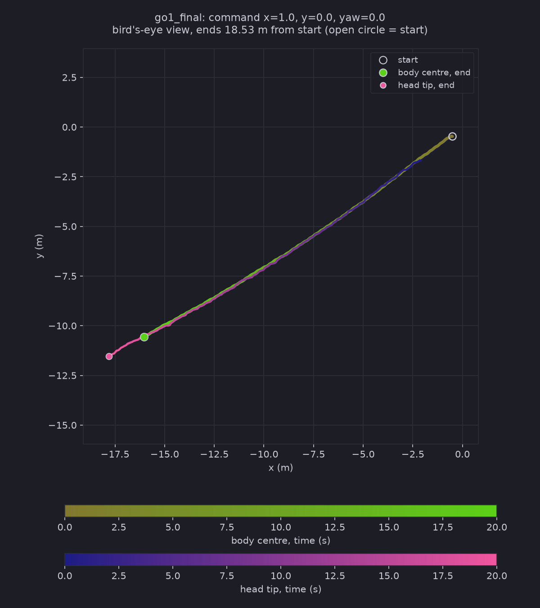

# HaiDuong

### Latest test: [Test 9.3](Tests/Test9.3/Test9.3.md)
**A new 100 m sine-wave ground: the Test 7 policy, trained on flat ground only, walks across it with speed tracking 0.92 (0.94 on flat ground). No training on this ground yet.**

 the new ground: two crossing sine waves, 0.4 m wavelength, crest heights from 1x to 1.5x, 100 x 100 m &nbsp;·&nbsp; the red box is a Go1-sized stand-in for scale &nbsp;·&nbsp; written by Claude, see <a href="Declaration.md">Declaration</a>

 tracking view and top view &nbsp;·&nbsp; command x = 1 (forward 1 m/s) &nbsp;·&nbsp; mean speed tracking 0.920 &nbsp;·&nbsp; first 6 s of a 20 s run
 full videos: <a href="Tests/Test9.3/x1.0_y0.0_yaw0.0/side_x1.0_y0.0_yaw0.0_SimpleUniFormRoughGround_1_go1_final.mp4">side</a> &nbsp;·&nbsp; <a href="Tests/Test9.3/x1.0_y0.0_yaw0.0/top_x1.0_y0.0_yaw0.0_SimpleUniFormRoughGround_1_go1_final.mp4">top</a> &nbsp;·&nbsp; <a href="Tests/Test9.3/x1.0_y0.0_yaw0.0/track_x1.0_y0.0_yaw0.0_SimpleUniFormRoughGround_1_go1_final.mp4">track</a>

 distance, velocity vs command and rotation &nbsp;·&nbsp; command x = 1, y = 0, yaw = 0 &nbsp;·&nbsp; 18.5 m in 20 s

 bird's-eye trail: body centre and head tip (drawn 2 m ahead), start to end &nbsp;·&nbsp; a nearly straight 18.5 m line

 

<table align="center">
<tr>
<td align="center" width="560">
<a href="Declaration.md"><b>What I use and where it comes from</b></a>
 libraries and versions &nbsp;·&nbsp; Matplotlib, pandas &nbsp;·&nbsp; MuJoCo Playground, Brax, JAX &nbsp;·&nbsp; Go1 model &nbsp;·&nbsp; WSL2 Ubuntu &nbsp;·&nbsp; use of AI &nbsp;·&nbsp; references
</td>
</tr>
</table>

<!-- Keep the fun fact as the last section of this README. New sections go above it. -->

> **Fun fact:** HaiDuong (Hải Dương) is my hometown in Vietnam. I have named the repo after it
> because it was windy this day and it reminds me of the autumn there.
